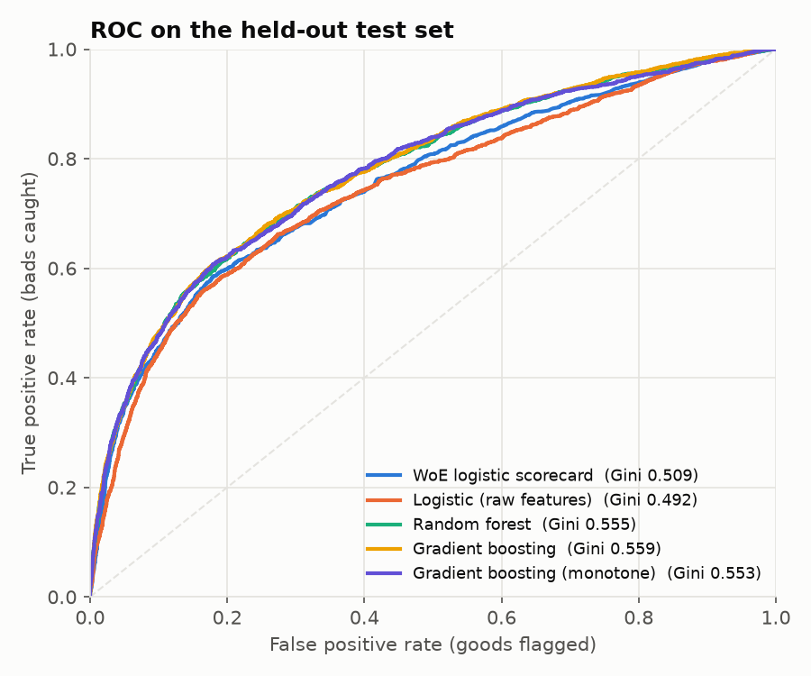
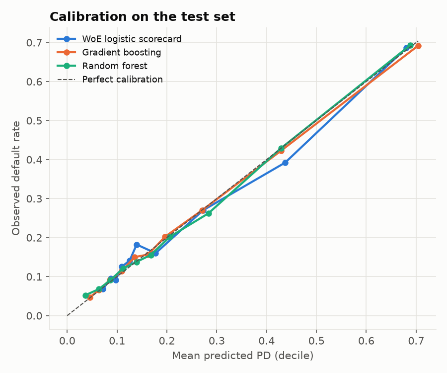
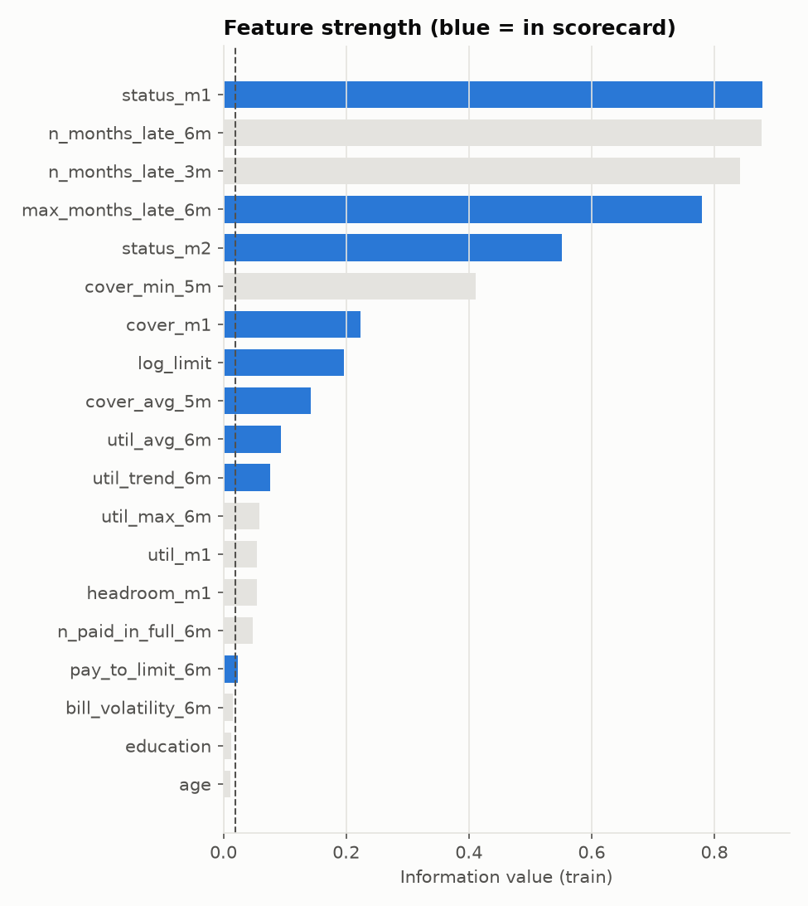
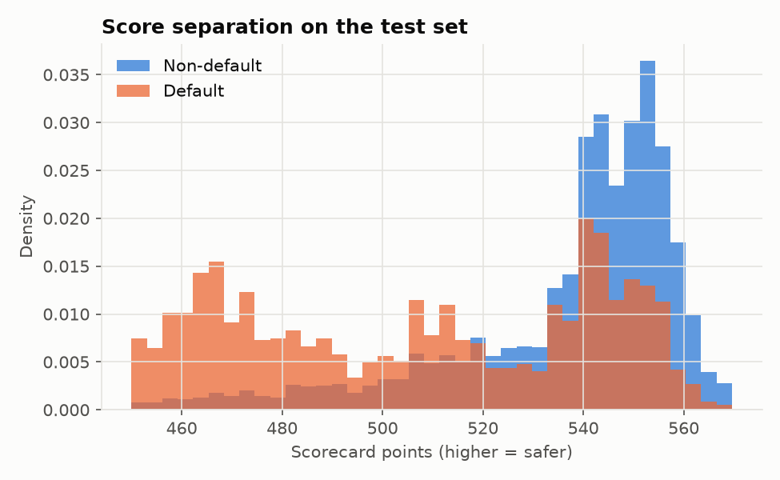
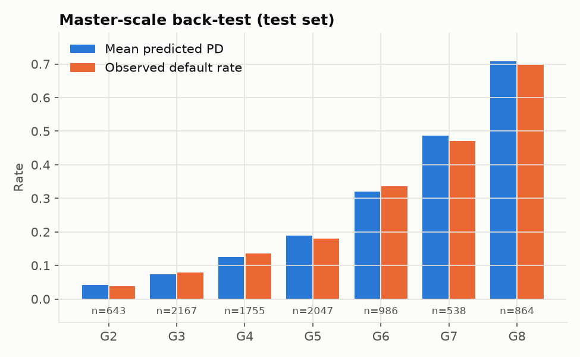
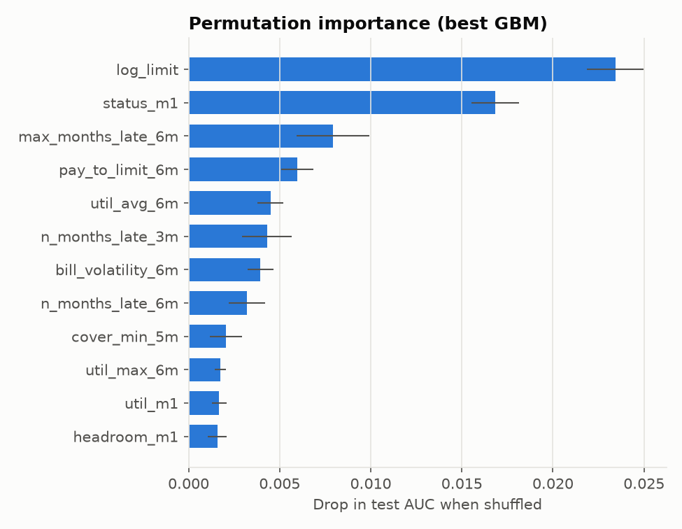
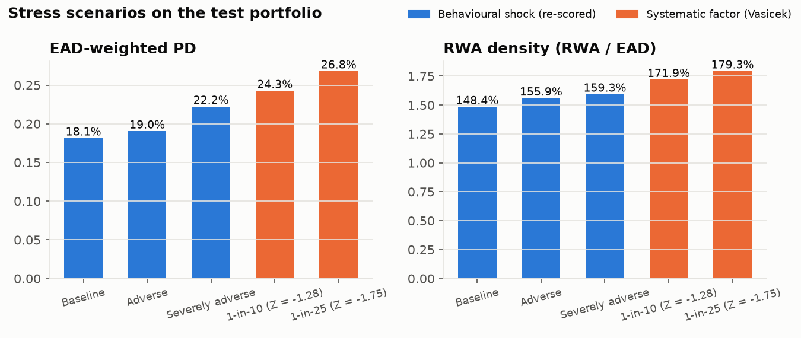

# Credit Card PD Model: Scorecard vs Machine Learning, with Validation and Stress Testing

A probability-of-default (PD) model for a retail credit-card book, built the way a bank
model-development team would approach it: a transparent **Weight-of-Evidence logistic
scorecard** as the benchmark, challenged by **gradient boosting** and **random forest**,
with **out-of-sample validation**, calibration back-testing, stability monitoring, and a
link from PD to **expected loss, Basel IRB capital and stress scenarios**.

Everything (WoE binning, IV selection, score scaling, IRB formula, stress engine) is
implemented from first principles in about 1,100 lines of Python on top of `scikit-learn`.

## Results

<!-- RESULTS:START -->
**Data:** 30,000 accounts, default rate 22.12%; stratified 70/30 split → 21,000 train / 9,000 test. Champion (selected on train CV AUC): **Gradient boosting**.

**Model comparison** (CV on train; all other columns on the untouched test set; Gini CI from 1000 stratified bootstrap resamples)

| model | CV AUC (train) | CV sd | Test AUC | Test Gini | Gini 95% lo | Gini 95% hi | KS | Brier | HL p-value |
|---|---|---|---|---|---|---|---|---|---|
| WoE logistic scorecard | 0.757 | 0.009 | 0.755 | 0.509 | 0.483 | 0.536 | 0.406 | 0.140 | 0.000 |
| Logistic (raw features) | 0.761 | 0.009 | 0.746 | 0.492 | 0.466 | 0.518 | 0.394 | 0.143 | 0.000 |
| Random forest | 0.788 | 0.008 | 0.777 | 0.555 | 0.531 | 0.579 | 0.421 | 0.135 | 0.201 |
| Gradient boosting | 0.790 | 0.007 | 0.779 | 0.559 | 0.535 | 0.583 | 0.428 | 0.135 | 0.897 |
| Gradient boosting (monotone) | 0.786 | 0.010 | 0.777 | 0.553 | 0.530 | 0.578 | 0.428 | 0.135 | 0.103 |

**Paired bootstrap: Gini uplift over the WoE scorecard**

| model | ΔGini vs scorecard | 95% lo | 95% hi | P(Δ ≤ 0) |
|---|---|---|---|---|
| Logistic (raw features) | -0.017 | -0.029 | -0.006 | 0.999 |
| Random forest | 0.046 | 0.031 | 0.060 | 0.000 |
| Gradient boosting | 0.050 | 0.035 | 0.064 | 0.000 |
| Gradient boosting (monotone) | 0.044 | 0.033 | 0.056 | 0.000 |

**Scorecard:** 9 of 19 features kept (IV ≥ 0.02, |ρ| ≤ 0.7, coefficient sign check; dropped for sign: n_paid_in_full_6m); final signs consistent: **yes**. Score PSI train→test (champion): **0.0005**.

**Master-scale back-test, champion, test set** (binomial test H0: DR = mean PD)

| grade | n | share | mean_pd | observed_dr | binom_p |
|---|---|---|---|---|---|
| G2 | 643 | 7.14% | 4.22% | 3.89% | 0.768 |
| G3 | 2167 | 24.08% | 7.32% | 7.84% | 0.343 |
| G4 | 1755 | 19.50% | 12.48% | 13.56% | 0.170 |
| G5 | 2047 | 22.74% | 18.89% | 18.08% | 0.366 |
| G6 | 986 | 10.96% | 32.00% | 33.67% | 0.260 |
| G7 | 538 | 5.98% | 48.75% | 47.03% | 0.438 |
| G8 | 864 | 9.60% | 70.91% | 69.79% | 0.477 |

**Stress test, test portfolio** (LGD 75%, CCF 50%, QRRE ρ = 0.04)

| Scenario | EAD-weighted PD | EL / EAD | RWA density |
|---|---|---|---|
| Behavioural: Baseline | 18.14% | 13.61% | 148.37% |
| Behavioural: Adverse | 19.04% | 14.28% | 155.88% |
| Behavioural: Severely adverse | 22.22% | 16.67% | 159.27% |
| Systematic: 1-in-10 (Z = -1.28) | 24.26% | 18.20% | 171.87% |
| Systematic: 1-in-25 (Z = -1.75) | 26.80% | 20.10% | 179.28% |

**Protected attribute check** (SEX is excluded from the model): female: observed DR 20.99%, mean PD 21.59%; male: observed DR 23.86%, mean PD 22.69%.

_Run time 186s._

<!-- RESULTS:END -->

| | |
|---|---|
|  |  |
|  |  |
|  |  |



## Data

[Default of Credit Card Clients](https://archive.ics.uci.edu/dataset/350/default+of+credit+card+clients)
(UCI Machine Learning Repository, CC BY 4.0; Yeh & Lien, 2009). 30,000 credit-card
accounts of a Taiwanese bank with six months of history (April–September 2005): credit
limit, monthly statement balances, monthly repayments and monthly repayment status.
Target: default on the October 2005 payment. The pipeline downloads the file on first run;
the Kaggle mirror `UCI_Credit_Card.csv` placed in `data/raw/` also works.

## Methodology

**1. Behavioural features** (`features.py`). Utilisation (level, max, 6-month trend),
repayment coverage (payment ÷ previous statement), arrears depth and frequency,
paid-in-full count, headroom, balance volatility, limit. **Sex and marital status are
excluded from the model inputs**; sex is used afterwards only to check for disparate
outcomes.

**2. WoE scorecard** (`woe.py`, `models.py`, `scorecard.py`). Per feature: quantile
pre-binning → merge bins below 5% of the population → merge adjacent bins until the bad
rate is monotonic → WoE and Information Value. Features with IV < 0.02 are dropped, then
the weaker of any pair with |ρ(WoE)| > 0.7. A logistic regression is fitted on the WoE
values and any feature whose coefficient has the wrong sign (a collinearity symptom) is
removed iteratively. Scores are scaled to 600 points at 50:1 odds with 20 points to double
the odds, and an integer points table is exported (`reports/scorecard_points.csv`).
Binning is a scikit-learn estimator, so it is refitted inside every CV fold: no leakage.

**3. Challenger models.** Logistic regression on raw standardised features, random forest,
histogram gradient boosting, and gradient boosting with **monotonic constraints**
(e.g. PD can only rise with arrears or utilisation), the usual compromise for using ML
in regulated PD models. GBM hyperparameters are tuned by randomised search with
5-fold CV on the training set only.

**4. Validation protocol** (`metrics.py`).

| Question | Test |
|---|---|
| Out-of-sample performance | Stratified 70/30 split; the 30% test set is untouched until final evaluation |
| Model selection | Champion chosen on **training-set 5-fold CV AUC**, never on the test set |
| Discrimination | AUC, Gini (accuracy ratio), KS |
| Is the ML uplift real? | Paired, stratified bootstrap of ΔGini vs the scorecard (95% CI, P(Δ ≤ 0)) |
| Calibration | Brier score, Hosmer–Lemeshow on PD deciles, reliability curve |
| Grade-level back-test | 8-grade PD master scale; binomial test of observed DR vs mean PD per grade |
| Stability | Population Stability Index of the score, train → test |
| Interpretability | IV, scorecard points, permutation importance for the GBM |
| Conduct risk | Observed default rate vs mean PD by sex (an attribute the model never sees) |

**5. From PD to capital and stress testing** (`capital.py`, `stress.py`).
EAD = drawn + CCF × undrawn. Expected loss = PD × LGD × EAD. Capital uses the Basel IRB
formula for qualifying revolving retail exposures (asset correlation 0.04, 99.9%
confidence, 0.10% PD floor). Two stress approaches:

* **Behavioural scenarios**: balances up, repayments down, roll-rates into arrears up;
  features are rebuilt and the champion model re-scores the book.
* **Systematic factor shift**: PDs conditioned on an adverse draw of the Vasicek
  macro factor (1-in-10 and 1-in-25 years), the mechanism that links macro scenarios to
  PDs in IFRS 9 and regulatory stress tests.

## Limitations and next steps

* **No out-of-time sample.** The data is a single six-month snapshot, so validation is
  out-of-sample but not out-of-time. A natural extension is a vintage-based dataset
  (e.g. Freddie Mac Single-Family Loan-Level or Lending Club) with an OOT hold-out.
* **Development-sample default rate (~22%) is far above a typical card book**, and
  2005 was Taiwan's credit-card debt crisis. Production PDs would be calibrated to a
  long-run average default rate (central tendency) before use.
* **LGD and CCF are assumptions** (75%, 50%), not models; the dataset has no recovery or
  drawdown history. Stress severities are illustrative, not a published scenario.
* Next: LGD model (beta regression / two-stage), macro satellite model linking
  unemployment and rates to the systematic factor, Jeffreys test for low-default grades.

## How to run

```bash
python -m venv .venv && source .venv/bin/activate      # Windows: .venv\Scripts\activate
pip install -r requirements.txt
python scripts/run_pipeline.py          # ~3-5 min on a laptop; --fast for ~1 min
python -m pytest -q                     # unit tests
```

Outputs: `reports/model_comparison.csv`, `woe_binning.csv`, `scorecard_points.csv`,
`grade_backtest_*.csv`, `stress_test.csv`, `permutation_importance.csv`,
`fairness_by_sex.csv`, `results.md` and `reports/figures/*.png`. The results block of
this README is refreshed automatically. `--synthetic` runs the whole pipeline offline on
fake data with the same schema (smoke test only).

## Repository layout

```
src/creditrisk/
  data.py         download, schema harmonisation, cleaning (+ synthetic generator for tests)
  features.py     behavioural features and monotonicity directions
  woe.py          WoE binning, IV, selection (scikit-learn transformer)
  models.py       WoE scorecard estimator, challengers, GBM tuning
  metrics.py      Gini, KS, Hosmer-Lemeshow, PSI, paired bootstrap
  scorecard.py    score scaling, points table, master scale, binomial back-test
  capital.py      EAD, expected loss, Basel IRB capital (QRRE)
  stress.py       behavioural and systematic-factor stress
  plots.py        figures
scripts/run_pipeline.py   end-to-end run
tests/                    unit tests
```

## Author

Javier Murgas, PhD in Mathematical Physics (University of Stavanger) ·
[LinkedIn](https://www.linkedin.com/in/javier-murgas-6212bb353)
